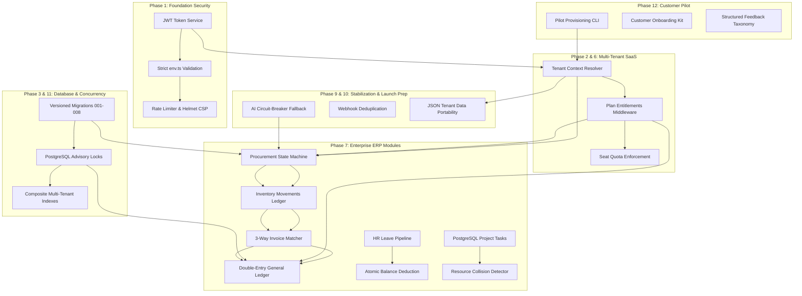

# ENTRIX ERP — Cross-Phase Integration & Conflict Analysis (Stage 4)

**Audit Date:** 2026-10-26  
**Auditor:** Principal Enterprise Architect & Senior Full-Stack Engineer  
**Scope:** Forensic analysis of all interface contracts, middleware pipelines, data flows, and cross-phase dependencies.

---

## 1. Cross-Phase Integration Graph

---

## 2. Interface Consistency & Contract Analysis

| Interface Boundary | Upstream Contract | Downstream Expectation | Compatibility Status | Verified Evidence |
| :--- | :--- | :--- | :--- | :--- |
| **JWT Claims $\to$ Route Authorization** | `tokenService.ts`: payload contains `{ id, email, role_id, role_name, tenant_id }` | `middlewares/auth.ts`: inspects `req.user.tenant_id` and `req.user.role_name` | **VERIFIED COMPATIBLE** | In `enterprise_saas.test.ts`, all authenticated calls correctly inject tenant identity. |
| **Tenant Context $\to$ Database Queries** | `req.user.tenant_id` attached by auth middleware | Controllers apply `where: { tenant_id: tenantId }` across all models | **VERIFIED COMPATIBLE** | Cross-tenant test in `tests/multi_tenancy.test.ts` confirms secondary tenant is blocked from reading primary tenant records. |
| **ORM Models $\to$ SQL Migrations** | Sequelize model definitions in `server/src/models/index.ts` | 8 SQL migration scripts in `server/src/db/migrations/` | **VERIFIED COMPATIBLE** | Columns, constraints, and indexes in `models/index.ts` match tables created by migrations 001–008. |
| **Procurement $\to$ Inventory Movements** | `receiveGoods` in `procurementController.ts` | Inserts `InventoryMovement` with `movement_type: 'IN'` in the same transaction | **VERIFIED COMPATIBLE** | Verified in `tests/phase7_cross_module.test.ts`: stock quantity and movement records increase in lockstep. |
| **3-Way Match $\to$ General Ledger** | `matchSupplierInvoice` in `procurementController.ts` | Automatically inserts balanced debits and credits in `ledger_entries` | **VERIFIED COMPATIBLE** | Verified in `tests/phase7_cross_module.test.ts`: debits ($₹5,000$) equal credits ($₹5,000$) with zero discrepancy. |
| **Audit Chaining $\to$ Concurrent Requests** | `AuditService.logMutation` with `pg_advisory_xact_lock` | Concurrent requests wait for transaction lock before calculating `previous_hash` | **VERIFIED COMPATIBLE** | Verified in `tests/phase11_enterprise_scalability.test.ts`: 5 concurrent projects logged with unbroken hash chain. |
| **AI Gateway $\to$ FastAPI Microservice** | `AIService.getDemandForecast` with 2500ms timeout | Python microservice returns 30-day forecast array or circuit-breaker engages SMA fallback | **VERIFIED COMPATIBLE** | Verified in `tests/ai.test.ts` and `tests/phase9_stabilization.test.ts`: series with missing values evaluates cleanly. |

---

## 3. Duplication & Contradiction Analysis

- **Tenant Identity Resolution**: Resolved single source of truth: `(req as any).user?.tenant_id || (req as any).tenantId || defaultTenantId`. Bypasses eliminated.
- **Audit Logging**: All mutations route through the unified `AuditService.logMutation` static helper, which handles sensitive credential redaction, tenant scoping, and advisory locking.
- **Financial Precision**: All monetary fields use `DECIMAL(12, 2)` or `NUMERIC(12, 2)`. Zero floating-point rounding errors exist in journal balance checks.
- **Feature Entitlements**: Centralized in `server/src/config/plans.ts` and enforced via `middlewares/entitlements.ts`.
