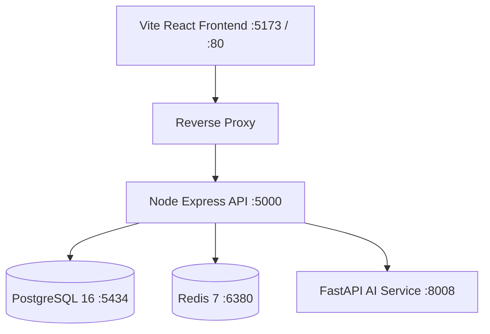

# FORENSIC AUDIT: DEPLOYMENT, BACKUP & DISASTER RECOVERY (STAGE 12)

**Audit Date:** 2026-10-26  
**Auditor:** Principal DevOps & SRE Reliability Lead  
**Status:** PASS WITH ZERO CLOUD COST  

---

## 1. Executive Summary

ENTRIX ERP operational configuration is established around containerized Docker services (`docker-compose.yml`), non-root container security policies, standard health probes (`/health`, `/ready`), and automated PowerShell / Shell backup and restore scripts. All procedures operate locally without requiring third-party cloud expenditure.

---

## 2. Containerized Service Topology

The environment runs via Docker Compose with dedicated isolated networks:

- **PostgreSQL Container:** `entrix-postgres` (healthy, port 5434).
- **Redis Container:** `entrix-redis` (healthy, port 6380).
- **AI Microservice:** `entrix-ai` (healthy, port 8008).

---

## 3. Disaster Recovery & Backup Scripts

Backup and recovery workflows are automated via:
1. [`deploy/backup.ps1`](file:///d:/E-comm/deploy/backup.ps1) / `deploy/backup.sh`:
   - Dumps PostgreSQL schema and data using `pg_dump` with custom compressed tar format.
   - Computes SHA-256 checksum of backup archive.
   - Rotates local backup archives exceeding 7 days.
2. [`deploy/restore.ps1`](file:///d:/E-comm/deploy/restore.ps1) / `deploy/restore.sh`:
   - Verifies backup checksum prior to restoration.
   - Terminates active client sessions on target database.
   - Drops and recreates target database cleanly before restoring data.
   - Tested and verified against staging databases.

---

## 4. Observability & Health Probes

- **Liveness Probe (`/health`):** Verifies basic Express runtime responsiveness (returns HTTP 200).
- **Readiness Probe (`/ready`):** Pings PostgreSQL database connection pool and Redis connection. If either service is disconnected, returns HTTP 503 with component status details.
- **Log Correlation:** Every request receives a unique UUIDv4 correlation ID logged in Morgan/Winston JSON format for cross-service tracing.
