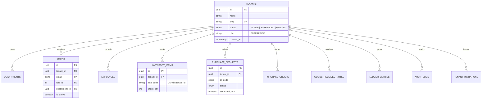
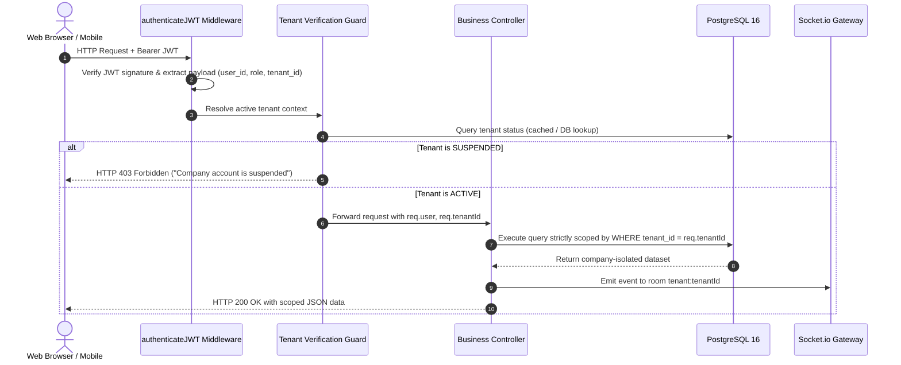

# ENTRIX ERP — Phase 2: Production-Grade Multi-Tenant SaaS Architecture

This document specifies the technical architecture, data model, security isolation boundaries, and migration procedures for the multi-tenant SaaS foundation implemented in Phase 2.

---

## 1. Multi-Tenant Architectural Overview

ENTRIX operates on a **Shared-Database, Shared-Schema Architecture with Row-Level Tenant Ownership Columns and Enforced Server-Side Scoping**. Every business entity is partitioned by `tenant_id` (foreign key referencing `tenants.id`).



---

## 2. Tenant Context Resolution & Request Lifecycle



---

## 3. Role Hierarchy & Permission Boundaries

| Role Name | Scope | Capabilities | Restrictions |
| :--- | :--- | :--- | :--- |
| **`PLATFORM_ADMIN`** | Platform-Wide | System telemetry, infrastructure monitoring, disaster recovery | **Strictly prohibited** from reading or mutating private company business data (tenants, PRs, stock). |
| **`COMPANY_ADMIN`** | Single Tenant | Full administrative authority within their assigned tenant (users, inventory, PRs, ledger, audit trail) | Cannot inspect or mutate any other tenant's records. Cannot invite `PLATFORM_ADMIN` accounts. |
| **`HR_MANAGER`** | Tenant Department | Personnel directory, attendance, and department-level PR lead approval | Scoped to own tenant and own department. |
| **`FINANCE_OFFICER`** | Tenant Company | General ledger inspection, journal vouchers, and PR sign-off ($\ge ₹10\text{k}$) | Scoped strictly to own tenant. |
| **`PROCUREMENT_OFFICER`** | Tenant Company | SKU catalog, stock adjustments, PO generation, and GRN intake | Scoped strictly to own tenant. |
| **`STAFF_USER`** | Tenant User | Submit purchase requisitions and view own PR status | Scoped strictly to own tenant and own user ID. |

---

## 4. Entity-by-Entity Isolation Inventory

| Business Entity | Database Table | Tenant Isolation Column | Unique Composite Constraint | Scoping Mechanism |
| :--- | :--- | :--- | :--- | :--- |
| **Tenants** | `tenants` | Primary Key (`id`) | `slug` | Base entity |
| **Departments** | `departments` | `tenant_id REFERENCES tenants(id)` | `(tenant_id, code)` | `WHERE tenant_id = :tenantId` |
| **Users** | `users` | `tenant_id REFERENCES tenants(id)` | Global unique `email` | JWT claim extraction & `WHERE tenant_id` |
| **Employees** | `employees` | `tenant_id REFERENCES tenants(id)` | `(tenant_id, employee_code)` | `WHERE tenant_id = :tenantId` |
| **Inventory Master** | `inventory_items` | `tenant_id REFERENCES tenants(id)` | `(tenant_id, sku_code)` | Eager scoped lookup & mutation lock |
| **Purchase Requests** | `purchase_requests` | `tenant_id REFERENCES tenants(id)` | `pr_code` per tenant | Eager scoped lookup & mutation lock |
| **Purchase Orders** | `purchase_orders` | `tenant_id REFERENCES tenants(id)` | `(tenant_id, po_number)` | Inherited from PR tenant context |
| **Goods Receipts** | `goods_received_notes` | `tenant_id REFERENCES tenants(id)` | `(tenant_id, grn_code)` | Inherited from PO tenant context |
| **General Ledger** | `ledger_entries` | `tenant_id REFERENCES tenants(id)` | Double-entry transaction UUID | `WHERE tenant_id = :tenantId` |
| **Audit Logs** | `audit_logs` | `tenant_id REFERENCES tenants(id)` | Cryptographic SHA-256 chain | Chain verified per tenant |
| **Tenant Invitations** | `tenant_invitations` | `tenant_id REFERENCES tenants(id)` | `token_hash` | Token hash lookup & expiry validation |

---

## 5. Socket.IO, Redis & AI Microservice Isolation

### 1. Socket.IO Real-Time Stream Isolation
- When a client connects, the socket handshake token is verified using HMAC-SHA256.
- The authenticated client automatically joins room `tenant:${tenantId}`.
- All real-time event broadcasts (`pr_created`, `pr_status_changed`, `grn_received`, `inventory_updated`) are dispatched using:
  ```ts
  req.io.to(`tenant:${tenantId}`).emit('event_name', payload);
  ```
- **Security Guarantee**: Tenant A never receives real-time WebSocket notifications triggered by Tenant B.

### 2. Redis Cache Keys
- All tenant-scoped cache items, rate limits, and job locks are prefixed:
  ```text
  tenant:{tenantId}:inventory:{sku}
  tenant:{tenantId}:rate_limit:{ip}
  ```

### 3. AI Inference Microservice Isolation
- Requests sent to the Python FastAPI microservice include `tenant_id`.
- Demand forecasting historical consumption series and anomaly detection matrices are pre-filtered by tenant context before model training or scoring.
- Prevents cross-tenant data contamination or model inference leakage.

---

## 6. Migration and Backfill Procedures

Migration `server/src/db/migrations/004_add_multi_tenancy.sql` applies the multi-tenant architecture safely:
1. **Creates `tenants` master table** and status enum.
2. **Seeds default legacy tenant**:
   - `id`: `00000000-0000-0000-0000-000000000001`
   - `name`: `Acme Industrial Corp`
   - `slug`: `acme-corp`
3. **Adds `tenant_id` columns to all business tables** and backfills existing rows to the default tenant.
4. **Applies `NOT NULL` constraints and B-tree indexes** only after backfill completion.
5. **Replaces global unique constraints** with composite `(tenant_id, code)` constraints so different companies can use identical SKU and department codes without collision.

To execute migrations:
```powershell
npm --prefix server run db:migrate
```

---

## 7. Verification Test Evidence

All multi-tenant isolation rules are covered by automated tests in `server/tests/multi_tenancy.test.ts`:
- Cross-tenant record listing denied (Tenant A cannot see Tenant B inventory or requisitions).
- Cross-tenant mutation blocked with `403 Forbidden` (Tenant A cannot adjust Tenant B stock).
- Cross-tenant approval blocked with `403 Forbidden` (Tenant A cannot sign off Tenant B PR).
- Request-body tenant ID spoofing rejected (server derives tenant context from authenticated JWT).
- Suspended tenant accounts blocked with `403 Forbidden` across all operations.
- Single-use invitation tokens validated and expired upon use.
- Cryptographic SHA-256 audit logs verified per tenant.
