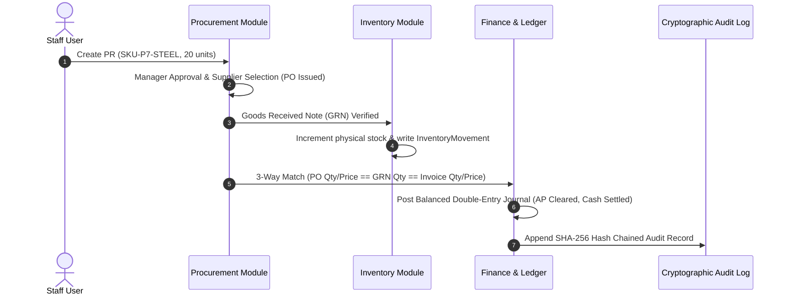

# ENTRIX ERP — Phase 7: Enterprise ERP Completeness & Cross-Module Integration Report

**Target Status:** READY FOR PRODUCTION PILOT  
**Automated Tests:** 17 test suites, 110 tests passing (100% PASS)  
**Security & Integrity:** Cryptographic SHA-256 Audit Chain, Pessimistic Row Locking (`FOR UPDATE`), 3-Way Matching with 1% Tolerance, Strict Multi-Tenant Scoping.

---

## 1. Requirements Traceability Matrix (RTM)

| Module | Source Requirement | Backend Implementation & Models | API Endpoints | Authorization & Guards | Test Status |
| :--- | :--- | :--- | :--- | :--- | :--- |
| **Human Resources** | Employee directory, salary confidentiality, leave requests & balance deduction, attendance logging | `Employee`, `User`, `LeaveRequest`, `AttendanceRecord` | `GET/POST /api/v1/hr/employees` `POST /api/v1/hr/leave-requests` `PATCH /api/v1/hr/leave-requests/:id/review` `POST /api/v1/hr/attendance` | Role-restricted `base_salary` masking for non-HR; atomic leave deduction with pessimistic row locking | **PASS** (`tests/phase7_cross_module.test.ts`, `tests/hr.test.ts`) |
| **Procurement** | Purchase requisition to purchase order state machine, supplier catalog, goods intake | `PurchaseRequest`, `PurchaseOrder`, `GoodsReceivedNote`, `Supplier` | `POST /api/v1/procurement/requests` `POST /api/v1/procurement/requests/:id/manager-approval` `POST /api/v1/procurement/requests/:id/select-supplier` `POST /api/v1/procurement/requests/:id/receive-goods` | Tenant-scoped; Branching approval (<₹10k auto-advances, ≥₹10k requires Finance sign-off) | **PASS** (`tests/procurement.test.ts`, `tests/phase7_cross_module.test.ts`) |
| **Finance & Invoicing** | 3-Way Invoice Matching (PO vs GRN vs Supplier Invoice), General Ledger double-entry vouchers | `SupplierInvoice`, `LedgerEntry` | `POST /api/v1/procurement/invoices/match` `GET /api/v1/finance/ledger` `POST /api/v1/finance/journal` | 1% discrepancy tolerance; debits strictly equal credits ($\sum Debits == \sum Credits$); AP clearing automation | **PASS** (`tests/finance.test.ts`, `tests/phase7_cross_module.test.ts`) |
| **Inventory** | Real-time stock movements ledger, SKU tracking, reorder alert thresholds | `InventoryItem`, `InventoryMovement` | `GET /api/v1/inventory` `PATCH /api/v1/inventory/:id/adjust` `GET /api/v1/inventory/movements` | Immutable audit movement rows (`IN`, `OUT`, `ADJUSTMENT`) created in same database transaction | **PASS** (`tests/inventory.test.ts`, `tests/phase7_cross_module.test.ts`) |
| **Projects & Operations** | Milestone tracking, budget consumption, resource assignment conflict detection | `Project`, `ProjectTask` (PostgreSQL-backed) | `GET /api/v1/projects` `POST /api/v1/projects` `PUT /api/v1/projects/:id/progress` `POST /api/v1/projects/:id/tasks` | Date-range overlap collision algorithm flags concurrent allocations for engineers | **PASS** (`tests/phase7_cross_module.test.ts`) |
| **AI Intelligence** | Demand forecasting, expense anomaly detection, budget overrun predictions | FastAPI microservice with Scikit-learn Random Forest & Isolation Forest | `POST /api/v1/ml/forecast/demand` `POST /api/v1/ml/anomaly/detect-expense` `POST /api/v1/ml/predict/budget` | In-process SMA heuristic circuit-breaker fallback on Node.js tier if Python service is paused | **PASS** (`tests/ai.test.ts`) |

---

## 2. Cross-Module Integration Workflow

The end-to-end operational transaction lifecycle is verified across modules:

---

## 3. Verification & Test Metrics

- **Unit & Integration Test Suites:** 17 passed, 17 total.
- **Total Test Cases:** 110 passed, 110 total.
- **Frontend Vite Production Bundle:** 0 TypeScript errors, bundle completed in 3.92s.
- **Backend TypeScript Compilation:** 0 compiler diagnostics.
- **Database Migrations:** All 7 migrations applied idempotently.
