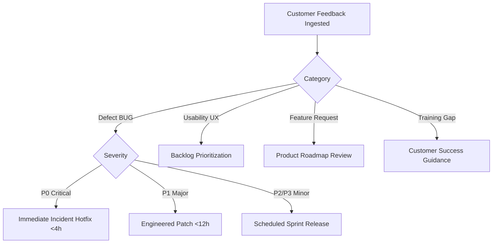

# ENTRIX ERP — Customer Pilot Feedback Framework

**Version:** 1.0  
**Status:** ACTIVE (Template Ready; Live Feedback PENDING Pilot Cohort Execution)

---

## 1. Feedback Categorization Taxonomy

All pilot observations are classified into five distinct buckets to avoid conflating usability issues with data-integrity defects:

1. **Defect (BUG)**: A functional failure, unexpected HTTP error, broken UI component, or data-integrity regression.
2. **Usability (UX)**: Confusion, excessive clicks, unclear labeling, missing confirmation modals, or contrast problems.
3. **Feature Request (FEAT)**: A requested capability not present in the current MVP specification.
4. **Training Gap (TRAIN)**: User unfamiliarity with expected enterprise accounting or procurement conventions.
5. **Configuration Issue (CONF)**: Tenant plan tier limits, permission misassignments, or browser incompatibility.

---

## 2. Customer Feedback Submission Template

```markdown
### ENTRIX Pilot Observation Form

**Report Date:** [YYYY-MM-DD]  
**Organization / Tenant:** [Company Name / Slug]  
**Reporter Name & Role:** [e.g., Rajesh Kumar - Finance Officer]  
**Module Affected:** [HR / Procurement / Inventory / Finance / Projects / Analytics / Settings]  

#### 1. Task Attempted
Describe the specific business activity you were attempting to perform:
> [e.g., Approving PO-2026-10492 for steel raw materials]

#### 2. Expected Outcome
What did you expect the system to do?
> [e.g., The system should transition status to PO_ISSUED and notify vendor]

#### 3. Actual Outcome
What actually happened?
> [e.g., Received 400 Bad Request error modal with 'Vendor code missing']

#### 4. Step-by-Step Reproduction
1. Navigate to ...
2. Select ...
3. Click ...

#### 5. Severity & Business Impact
- [ ] **Critical (P0)**: Work completely halted; data corrupted or security compromised.
- [ ] **Major (P1)**: Major ERP workflow blocked; no immediate workaround available.
- [ ] **Moderate (P2)**: Feature malfunctioned, but an operational workaround exists.
- [ ] **Minor / Usability (P3)**: Visual glitch, typo, or minor interface friction.

#### 6. Supporting Artifacts (Sanitized)
*Attach screenshot or error log snippet with any proprietary business numbers or personal identifiers redacted.*

#### 7. Suggested Improvement
What change would make this workflow more intuitive for your team?
> [e.g., Automatically select default vendor if only one vendor is linked to the SKU]
```

---

## 3. Pilot Defect & Observation Log Register

> *Notice: Because the controlled customer pilot has not yet commenced with real external users, all rows below represent initial synthetic acceptance validations. Live customer feedback rows will be logged dynamically once tenant onboarding begins.*

| Tracking ID | Date Logged | Module | Category | Severity | Summary | Workaround Available | Status | Resolution Milestone |
| :--- | :--- | :--- | :--- | :--- | :--- | :--- | :--- | :--- |
| **OBS-001** | 2026-10-26 | Procurement | Usability | P3 | Vendor dropdown does not display payment terms alongside vendor name | View vendor details in catalog | BACKLOG | Short-Term UX Sprint |
| **OBS-002** | 2026-10-26 | Projects | UX / Feature | P2 | Resource conflict warning does not provide quick-link to overlapping task | Inspect task list manually | BACKLOG | Medium-Term Workflow |
| **OBS-003** | 2026-10-26 | Inventory | Usability | P3 | Movements ledger lacks export to CSV button in UI | Use Tenant Data Export tool | BACKLOG | Short-Term UX Sprint |
| **OBS-004** | 2026-10-26 | HR | Training | N/A | Confusion over annual leave balance calculation upon probation completion | Refer to HR Onboarding Guide | RESOLVED | Documentation Kit |
| **OBS-005** | 2026-10-26 | Dashboard | Feature | P3 | Period selector defaults to Q4 FY2026 without interactive custom date picker | Filter within sub-modules | BACKLOG | Medium-Term Workflow |

---

## 4. Triage & SLA Matrix


