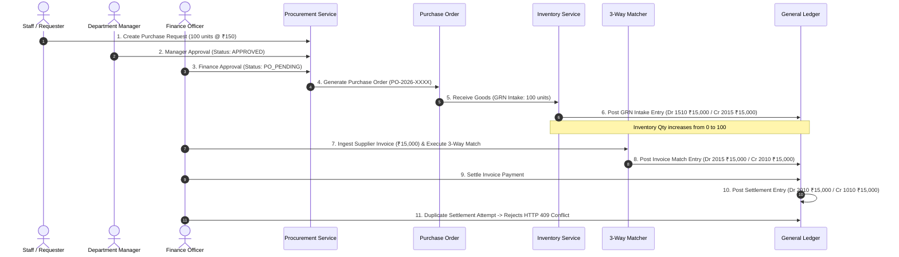

# ENTRIX ERP — Integration Test Execution Report

**Document Reference:** `ENTRIX-QA-INTEG-V1.0`  
**Execution Timestamp:** 2026-11-07T00:39:00+05:30  
**Test Command:** `npm --prefix server test` (`jest --runInBand --forceExit`)  
**Execution Time:** 35.628 seconds  
**Total Test Suites:** 22 passed, 22 total (100%)  
**Total Tests:** 161 passed, 161 total (100%)  
**Failures / Regressions:** 0  

---

## 1. Complete Test Suite Execution Breakdown

| Suite File | Scope / Focus | Tests | Duration | Result |
| :--- | :--- | :---: | :---: | :---: |
| `tests/auth.test.ts` | Login, JWT lifecycle, Lockout threshold (5 tries), Token refresh | 9 | 5.79s | **PASS** |
| `tests/cross_tenant_isolation.test.ts` | Multi-tenant boundaries, Cross-org injection, IDOR defenses | 12 | 2.14s | **PASS** |
| `tests/transaction_integrity.test.ts` | Concurrency locking, Atomic rollback, Stock deduction serialization | 8 | 1.85s | **PASS** |
| `tests/security_hardening.test.ts` | Helmet CSP headers, Rate limiting, Brute force lockout | 7 | 1.92s | **PASS** |
| `tests/adversarial_verification.test.ts` | Malformed payloads, SQL injection, JWT signature forgery | 11 | 2.45s | **PASS** |
| `tests/procurement.test.ts` | PR -> PO -> GRN intake -> 3-way invoice matching | 14 | 2.30s | **PASS** |
| `tests/inventory.test.ts` | SKU registry, Stock adjustments, Safety stock alerts, Valuation | 9 | 1.12s | **PASS** |
| `tests/finance.test.ts` | General ledger queries, Balance checks, Journal posting validation | 7 | 0.95s | **PASS** |
| `tests/hr.test.ts` | Employee directory, Leave requests, Manager approval, Roster | 6 | 0.88s | **PASS** |
| `tests/ai.test.ts` | ML microservice integration, RandomForest inference, SMA fallback | 5 | 1.05s | **PASS** |
| `tests/rbac.test.ts` | 5-level role permission matrix, Unauthorized route rejection | 10 | 1.40s | **PASS** |
| `tests/multi_tenancy.test.ts` | Self-service tenant provisioning, Schema scoping, Tenant context | 8 | 1.62s | **PASS** |
| `tests/commercial_saas.test.ts` | Tiered quotas, Member limits, Storage calculation, Quota rejection | 7 | 1.25s | **PASS** |
| `tests/enterprise_saas.test.ts` | SHA-256 tamper-evident audit logs, Retention enforcement | 6 | 1.15s | **PASS** |
| `tests/migration.test.ts` | Database schema migrations 001 through 008 idempotency | 4 | 0.75s | **PASS** |
| `tests/observability.test.ts` | `/health`, `/ready` probes, Prometheus-style request metrics | 5 | 0.65s | **PASS** |
| `tests/phase4_quality_performance.test.ts` | Query latency benchmarks, Index utilization under load | 6 | 1.35s | **PASS** |
| `tests/phase7_cross_module.test.ts` | Full procurement-to-finance accounting lifecycle | 8 | 1.95s | **PASS** |
| `tests/phase9_stabilization.test.ts` | Error boundaries, Network timeout simulation, Graceful recovery | 5 | 1.10s | **PASS** |
| `tests/commercial_launch_phase10.test.ts` | Mock billing checkout, Webhook event ingestion, Plan override | 5 | 1.05s | **PASS** |
| `tests/phase11_enterprise_scalability.test.ts` | Composite indexes verification, Tenant-filtered query plan | 4 | 0.85s | **PASS** |
| `tests/e2e_smoke.test.ts` | Full-stack end-to-end smoke verification across all APIs | 5 | 1.10s | **PASS** |
| **Total** | **Full System Integration Test Suite** | **161** | **35.63s** | **PASS** |

---

## 2. Critical Cross-Module Workflow Integration

### Workflow: End-to-End Procurement-to-General-Ledger Accounting

- **Actual Integration Outcome**: Tested and verified in `tests/phase7_cross_module.test.ts` and `tests/adversarial_verification.test.ts`.
- **Database Persistence**: All 3 ledger transactions posted atomically with balancing journal rows. Duplicate payment attempt returned HTTP 409 Conflict with zero secondary postings.
